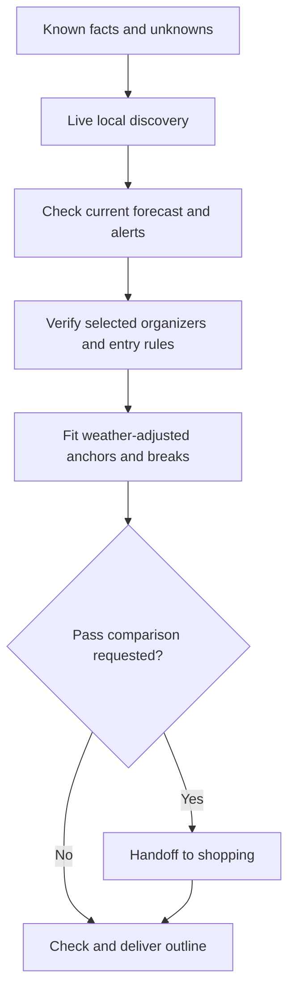

# Plan a Houston Weekend With Kids

Discover current local activities, check weather, and build a manageable two-day plan before comparing passes.

## Continued From SKILL.md

Enter from the selected scenario in `SKILL.md`. Accept an existing outline after checking its request, dates, evidence age and unresolved items. Reuse valid work when one constraint changes.

## Resources

- Before choosing anchors, read `references/houston-planning.md` in full.
- Before discovery and weather checks, read `references/local-discovery-and-weather.md` in full.
- Before the deliverable or shopping handoff, read `schemas/weekend-output.md` in full.
- Before public-source commands or results, read `schemas/command-rules.md` in full.
- Before trip inputs and tools, read `references/privacy-and-capabilities.md` in full. For pass comparison, the current agent can own comparison under the bundled contract; an appropriate installed shopping skill is optional. Read its actual entry point before a handoff. Planning owns feasibility; the comparison role owns price/product calculations.

## Step 1: Establish the usable weekend and requirements

Separate allowed facts from unknowns: usable weekend windows, each child's anonymous admission categories, child/adult counts, interests, must-dos, budget, transport and pace. Accept deliberately supplied dates/timing only when the caller's policy permits model use. If that policy protects dates or other necessary details, keep them in local human-entry tools and use qualified bounded fit results instead. Do not infer party counts or turn “a weekend” into the next weekend. Houston timed plans/examples use `America/Chicago`.

Ask only for inputs that change the decision and are permitted by the caller's policy. Anonymous admission categories, counts, budget, interests and permitted planning dates can be deliberately supplied. Request protected values only through a supported local human-entry tool. Names, birthdates, booking references and exact addresses are unnecessary for initial research. Verify any private adapter's actual bounded output contract before use. If required protected-fit tooling is missing, explain the gap and keep affected claims conditional. A host using policy-permitted dates needs no private-date adapter; still distinguish unverified capacity from checked rules.

With missing permitted dates/fit results or admission categories, compare a small number of patterns and label them provisional; leave dependent money/eligibility fields unknown. Accept this step when known facts, consequential gaps and independent work are clear.

## Step 2: Discover current local places and activities

Search the live public web for the children's interests and relevant Houston neighborhoods, using only permitted non-sensitive inputs. Use current community/organizer calendars and a separate resident-oriented channel, such as a local parenting guide, neighborhood publication or public resident discussion. Search for family workshops, library programs, nature walks, markets, cultural events, neighborhood play spaces and seasonal activities as relevant. Broaden beyond the saved attraction sources and pass listings; stop expanding when the shortlist has credible variety and further searches would not change the choice.

Treat resident recommendations as leads, not verified event details or proof that a place is a local secret. Check posting year, recurrence and age fit; old weekend lists often resurface. Carry forward suitable non-pass/free choices as real alternatives, with why they fit. If none fits, explain the evidence and exclusion rather than fabricating variety. Private dates must not be inserted into searches; unresolved date matching keeps a dated event provisional.

Accept this step when the shortlist shows discovery beyond tourist/pass catalogs, source origins and what still needs organizer confirmation. Specific user-selected visits may bypass new discovery, but do not describe that narrow scope as a broad Houston search.

## Step 3: Check weather before selecting outdoor blocks or tickets

Retrieve current official Houston-area forecasts and alerts using public locations; start with NWS Houston/Galveston and the forecast for the relevant public venue area. Record the check time, forecast issue/update time when available, area, valid periods, temperature/heat information, rain timing, thunderstorms, wind and applicable alerts. Use hourly detail when available for planned outdoor blocks, queues, travel and exposed components of otherwise indoor visits. Also check the selected operator's weather/closure policy.

Apply the privacy/date and forecast-horizon branches in `references/local-discovery-and-weather.md`, section "Weather decisions". Unknown/private-unmatchable dates or a trip outside the published forecast window do not justify skipping retrieval: inspect available public conditions, state what they cover, and keep trip matching provisional. Current weather is not a future-weekend forecast. Retrieval failure remains an explicit gap, never evidence of good weather.

Change the plan when the checked conditions warrant it: move exposed blocks, reduce heat/walking exposure, choose a verified indoor replacement, or defer an affected nonrefundable purchase. Explain the condition behind a change or why no change is needed. An indoor substitute must fit the same interests, hours, capacity and travel budget. Do not interpret a daily rain percentage as an all-day washout or ignore an official warning because rain probability is low.

Accept this step only when weather was checked with evidence and consequences, or a precise unavailable/unmatched result limits the plan to conditional status. Recheck before separately authorized weather-sensitive purchases and shortly before the outing; do not schedule a reminder without a request.

## Step 4: Check the public rules governing selected visits

Use official attraction pages for selected experiences and METRO for relevant transit. The bundled reference is a starting map, not a future-date promise. Match policy-permitted dates to current public occurrence/rules directly; when necessary dates are protected, require qualified bounded fit results or keep affected matching conditional. Public research can establish opening/closure rules, last entry, timed shows, reservation channel/lead time, relevant age/height restrictions, parking/arrival allowance and public food/access policy. Do not claim live capacity without observing it through an allowed interface.

For Space Center, identify visit depth and the selected tram before allocating a block. Check Mission Control's distinct paid advance rules and the included on-site first-come tour rules; admission alone does not guarantee a seat. For HMNS, distinguish permanent halls from separately timed attractions. For the Zoo, check the intended admission channel's timed entry rules; pass instructions return through shopping.

Where operational pages conflict with marketing, use the specific current rule and disclose consequential unresolved contradictions. Do not use an “hours today” footer or generic tourism drive time as evidence for future entry or door-to-door travel.

For newly discovered programs, open the current organizer's exact listing to confirm occurrence/year, day/time, age suitability, public access or residency/membership requirements, registration/capacity, charges, weather cancellation and last entry. A calendar snippet or recurring-program label alone does not confirm that weekend's occurrence. Reject expired/cancelled leads or leave them unverified. Accept this step when applicable rules have official links/observation dates or are explicitly unverified.

## Step 5: Fit a realistic two-day outline

Choose one or two coherent daily anchors from the verified discovery shortlist, children's priorities and weather assessment. Neighborhood programs, parks, workshops or community events can anchor a day just as a major attraction can. Use the Museum District and Space Center patterns only when they win on fit; they are not default itinerary slots. Keep farther optional visits as swaps unless the whole day still fits.

Work forward from an allowed usable window and backward from last entry/departure feasibility. Keep timing protected by the caller's policy opaque. Include:

- Dwell time and exactly which experiences it covers. Use published durations where available and label planning estimates.
- Travel from a deliberately disclosed non-sensitive broad area, parking, walk-in, security/queue and transfers. Exact-address routing needs a safe supported boundary; otherwise show route uncertainty.
- Meals, restrooms and rest/quiet time at the family's pace. A nearby second venue still needs movement and recovery time.
- Reservation/show/check-in windows and closing/last-boarding cutoffs. Overlap with travel, meals or another tour fails the fit check.
- A weather/capacity alternative replacing the affected visit, with the forecast or operator condition that triggers it. Check its admission and timing; an indoor label does not guarantee all components remain open.

Check visit time + movement/entry + meals/rest + fixed slots against each day's actual window. Do not compress breaks or add unwanted venues to justify a bundle. If a day fails, remove/swap its lowest-priority visit and recheck affected blocks. If a must-do remains infeasible, state the conflict and ask the user to choose the trade-off. Accept when anchors fit to the stated evidence level and optional items are clearly optional.

## Step 6: Hand feasible admissions to pass shopping

Skip for planning-only work. Otherwise use `schemas/weekend-output.md`, section "Pass-shopping handoff", to pass minimum relevant fields to the comparison role. The current agent owns this role unless an appropriate installed shopping skill is available under `references/privacy-and-capabilities.md`, section "Optional shopping integration". Keep categories separate under each product's rules and preserve unknowns. Identify essential add-ons without assuming coverage.

The comparison role checks desired admissions, permitted usable-date fit and authority before pricing. Use the full activity basket, including free/non-pass activities, weather exposure, substitutes and reduced-use possibilities. Return current official options, a no-pass baseline, category mapping, mandatory totals/exclusions, activation/expiry rules, reservations, cancellation/return terms and evidence limits. Keep price math and promotion rules in this comparison. If required public evidence or permitted category/date-fit inputs are unavailable, return the ready handoff and mark affected comparison fields pending; a missing optional installed skill alone is not a blocker.

Accept an option only when its terms fit the plan: whether a reservation starts validity, how first use activates, whether all dates fit, whether weather or unavailable slots defeats must-dos and whether a child's free/direct admission changes suitability. Reprice after weather or local alternatives remove paid visits; do not keep an obsolete savings claim. Return price/terms defects to shopping, weather gaps to Step 3 and schedule defects to Step 5. Stop an unchanged loop once the missing source or user choice is clear.

## Step 7: Reconcile and deliver

Check permitted dates/time fit or supported bounded results, route uncertainty, retained breaks, local discovery evidence and whether every recommended admission is desired and realistically usable. Include a weather summary with source/check time/coverage and its concrete effects, or clearly state the unavailable/unmatched check. Generic weather-swap text alone does not pass. Missing essential protected-fit evidence keeps affected claims conditional; permitted-date planning may be checked without a private adapter. Label unobserved capacity separately. Reconfirm volatile availability/terms before any separately authorized purchase or booking through an allowed boundary; research does not hold tickets.

Return the outline/recommendation under `schemas/weekend-output.md`. Explain fit to interests and the two-day limit; include the next necessary input/action, observation dates and gaps that change the recommendation. Do not claim reservations, purchases, capacity or totals that were not checked. Stop after the requested result; saving trip notes or reminders requires its own authorization.

## Gotchas

- Admission bands differ; “two kids” is insufficient for final eligibility/totals.
- General admission, a pass, timed entry and a tram boarding pass are distinct entitlements.
- Free weekday/evening programs may not apply to Saturday/Sunday.
- Queues, weather and NASA operations can invalidate a tight cross-city day.
- Tourism lists discover candidates; selected venue rules govern timed plans.
- A fixed source snapshot misses neighborhood programs and changing events; a live result can still be outdated or cancelled.
- Missing dates, forecasts outside their published window and failed weather retrieval are different gaps; none establishes favorable trip weather.

## Checklist

- [ ] Dates/categories/adult count were not invented.
- [ ] Open-ended discovery extends beyond tourist/pass catalogs with organizer verification or visible gaps; an explicitly fixed user-selected scope is labeled and preserved.
- [ ] Official forecast/alerts were retrieved; time, area, coverage and effects on outdoor blocks/ticket choices are explicit, or the plan is conditional for a named gap.
- [ ] Anchors, movement/arrival, food/rest and weather/capacity swaps fit.
- [ ] Official links, observation dates, cutoffs and unavailable checks are clear.
- [ ] Shopping covers desired feasible visits and its terms are reconciled.
- [ ] Proposed, checked, reserved and purchased states remain distinct.

## Recovery from interruption

Inspect the actual request, outline, accepted inputs and source/quote dates. Recheck stale event occurrence and forecasts; return to Step 2 for expired local candidates, Step 3 for changed weather and Step 5 for affected timing, then Step 6 if paid use changes. Check an uncertain reservation/purchase outcome before any retry. Preserve unaffected accepted work and keep protected values outside context in handoffs. Use the host's authorized maintenance system when available; do not save private task records in this bundle.

## Handoff

Producer: This procedure. Receiver: The user for planning-only work; the current agent's comparison role or an optional compatible shopping skill at Step 6, then this procedure accepts the terms. Deliverable: Known/unknown facts, local discovery evidence, weather assessment, prioritized feasible activities, daily outline and evidence under `schemas/weekend-output.md`. The receiver checks scope, categories/date-fit, freshness, weather, timing and authority. Return cost/terms gaps to comparison, timing/source defects to their owning step and essential non-sensitive preferences to the user. Deliver the checked or explicitly provisional result and stop; no external action is implied.
